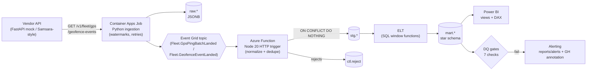

# FleetEventPipeline

An event-driven telematics data pipeline modelled on how a heavy-civil
construction contractor ingests equipment data from a vendor API (Samsara-style),
fans it out through Azure Event Grid, lands it in PostgreSQL, transforms it into a
dimensional model, gates it with data-quality checks, and publishes a
Power BI–ready semantic layer for equipment utilization.

The problem it solves: contractors run mixed fleets of excavators, dozers, haul
trucks and pickups across many job sites. Telematics data arrives incrementally
from a vendor, is often late, duplicated or malformed, and is only useful once it
is modelled into utilization, idle and geofence-dwell metrics that project
managers can trust. This repo is a complete, runnable reference for that flow —
no Azure account required, because Event Grid is emulated by a local publisher
that speaks the real Event Grid event schema.

## Architecture



**Azure service mapping**

| This repo (local) | Azure |
| --- | --- |
| `src/ingest/job.py` (`python -m src.ingest.job`) | Azure Container Apps Job (or timer-triggered Function) |
| `src/mockapi/` (FastAPI on :8099) | Vendor SaaS API |
| `src/ingest/eventgrid.py` publisher | Azure Event Grid custom topic |
| `handler/src/index.js` (Node, :7099) | Azure Function, Event Grid HTTP trigger |
| `docker-compose` Postgres 16 | Azure Database for PostgreSQL Flexible Server |
| `reports/metrics.json` + DQ alerts | Application Insights / Power Automate |

**Switching the emulated Event Grid to a real topic (config only)**

The publisher picks its sink purely from configuration:

```bash
# Local / emulated (default): envelopes POST to the Functions-style handler.
EVENTGRID_ENDPOINT=
HANDLER_URL=http://localhost:7099/api/eventgrid

# Real Event Grid: set the topic endpoint + key. No code change.
EVENTGRID_ENDPOINT=https://<topic>.eastus-1.eventgrid.azure.net/api/events
EVENTGRID_KEY=<topic-access-key>          # sent as the aeg-sas-key header
```

`src/ingest/eventgrid.py` builds standard Event Grid schema envelopes
(`id`, `eventType`, `subject` = `/fleet/vehicles/<id>`, `eventTime`,
`dataVersion`, `data`) and batches them ≤100 per POST. In emulated mode the
*identical* envelopes go to `HANDLER_URL`, and a JSON log line notes the mode.

## How to run

Prerequisites: Docker, Python 3.11+, Node 20+, `make`.

```bash
cp .env.example .env
python3 -m venv .venv && .venv/bin/pip install -r requirements.txt
npm install
docker compose up -d            # PostgreSQL 16 on localhost:55432
make demo                       # migrate -> api -> handler -> ingest -> elt -> dq -> report
make test                       # pytest + node:test
```

`make demo` starts the mock vendor API and the Event Grid handler in the
background, runs the full pipeline, writes `reports/run_report.md` and
`reports/metrics.json`, and stops the background processes. `make help` lists
every target (`up`, `down`, `api`, `handler`, `ingest`, `elt`, `dq`, `report`,
`demo`, `test`, `lint`, `fmt`).

**Power BI**

- Import `powerbi/exports/*.csv` (produced by `python scripts/export_powerbi.py`)
  to build the dataset without a database, or
- point Power BI (DirectQuery/Import) at the `mart.vw_*` views in PostgreSQL.
- Measures live in `powerbi/measures.dax`; the model, relationships, storage mode,
  incremental refresh and RLS are documented in `powerbi/model.md`; the three
  report pages are specified in `powerbi/dashboard_spec.md`.

## Data model

Star schema in the `mart` schema (`sql/01_dimensional.sql`). Grain:

| Table | Grain |
| --- | --- |
| `dim_vehicle` | one row per asset (make/model/year, asset_type, home_yard) |
| `dim_operator` | one row per operator |
| `dim_geofence` | one row per job-site/yard geofence (site name, job number, bbox) |
| `dim_date` | one row per calendar day |
| `dim_time_of_day` | one row per clock hour (with time bucket) |
| `fact_gps_ping` | one row per deduplicated GPS ping (point-to-point `distance_km`, moving/idling flags) |
| `fact_trip_segment` | one row per continuous moving segment per vehicle (distance, avg/max speed, start/end geofence) |
| `fact_idle_event` | one row per contiguous engine-on + speed<2 kph window ≥5 min |
| `fact_geofence_transition` | one row per entry→exit pair resolved into dwell (`unmatched_flag` for orphans) |

The segment/idle/transition derivations use SQL window functions (`LAG`/`LEAD`,
gaps-and-islands), not Python loops.

## Results

Every number below is copied verbatim from `reports/metrics.json` produced by
this build (run id `99acd073-c992-4721-a090-3c43f10b44d3`).

### Headline

| Metric | Value |
| --- | --- |
| Events ingested (read) | 165,426 |
| Rows raw-landed | 165,426 |
| Duplicates blocked | 3,105 |
| Dedupe recall (blocked / injected) | 97.46% |
| Rows rejected | 4,009 |
| Ingestion wall-clock | 23.431 s |
| Throughput | 7,060.1 rows/s |
| Retries through injected 429/503 | 5 |
| Total pipeline runtime | 37.92 s |
| DQ gates passed | 7 / 7 |

### Rows per table

| Raw | Rows | Staging | Rows | Mart | Rows |
| --- | --- | --- | --- | --- | --- |
| `gps_ping_raw` | 162,034 | `gps_ping` | 154,920 | `fact_gps_ping` | 154,920 |
| `geofence_event_raw` | 3,392 | `geofence_event` | 3,392 | `fact_trip_segment` | 4,887 |
| | | `vehicle` | 40 | `fact_idle_event` | 4,695 |
| | | `operator` | 24 | `fact_geofence_transition` | 1,720 |
| | | `geofence` | 9 | `dim_vehicle` / `dim_operator` / `dim_geofence` | 40 / 24 / 9 |
| | | | | `dim_date` / `dim_time_of_day` | 29 / 24 |

### Rejected rows by reason code

| reason_code | rows |
| --- | --- |
| LATE_ARRIVING | 1,574 |
| MISSING_GPS | 844 |
| NULL_ISLAND | 834 |
| OUT_OF_RANGE_LATLON | 757 |
| **total** | **4,009** |

### Injected vs caught defects

| Defect | Injected | Caught | Recall |
| --- | --- | --- | --- |
| duplicate_events | 3,186 | 3,105 | 97.46% |
| late_arriving | 1,577 | 1,574 | 99.81% |
| null_gps | 819 | 844 | 103.05% |
| null_island | 809 | 834 | 103.09% |
| out_of_range | 738 | 757 | 102.57% |
| unmatched_geofence_exits | 8 | 8 | 100.00% |
| stale_vehicles | 3 | 3 | 100.00% |

Recall slightly exceeds 100% for some coordinate defects because duplicates of
already-defective events are themselves rejected, so the same injected defect is
counted twice (see Limitations).

### Fleet utilization / idle by asset type

| asset_type | moving_hours | idle_hours | utilization | idle |
| --- | --- | --- | --- | --- |
| dozer | 1,295.22 | 494.81 | 72.36% | 27.64% |
| excavator | 1,328.40 | 478.00 | 73.54% | 26.46% |
| haul_truck | 1,333.10 | 479.15 | 73.56% | 26.44% |
| pickup | 1,327.43 | 488.24 | 73.11% | 26.89% |

### Top 10 idle assets (hours)

| vehicle_id | name | asset_type | idle_hours |
| --- | --- | --- | --- |
| VEH-004 | Unit 004 | pickup | 55.85 |
| VEH-018 | Unit 018 | dozer | 54.44 |
| VEH-023 | Unit 023 | haul_truck | 53.07 |
| VEH-011 | Unit 011 | haul_truck | 52.59 |
| VEH-037 | Unit 037 | excavator | 52.41 |
| VEH-019 | Unit 019 | haul_truck | 51.96 |
| VEH-024 | Unit 024 | pickup | 51.72 |
| VEH-009 | Unit 009 | excavator | 51.46 |
| VEH-038 | Unit 038 | dozer | 51.45 |
| VEH-012 | Unit 012 | pickup | 51.15 |

### Geofence activity by site

| site | job | entries | exits | mean_dwell_min |
| --- | --- | --- | --- | --- |
| Fairview Site 1 | J-1000 | 146 | 147 | 486.23 |
| Summit Site 2 | J-1007 | 147 | 147 | 480.50 |
| Bluffs Site 3 | J-1014 | 146 | 147 | 472.74 |
| Cedar Site 4 | J-1021 | 147 | 147 | 482.15 |
| Summit Site 5 | J-1028 | 126 | 126 | 477.66 |
| Summit Site 6 | J-1035 | 126 | 126 | 479.71 |

### Data-quality gates (observed vs threshold)

| check | result | observed | threshold | detail |
| --- | --- | --- | --- | --- |
| freshness | PASS | 2.8821 | 720.0 | newest `2026-10-12T18:11:31Z`; stale_vehicles(3)=VEH-030:77.7h, VEH-016:77.1h, VEH-034:75.7h |
| duplicate_rate | PASS | 1.877 | 5.0 | deduped=3,105 total=165,426 |
| invalid_gps_reject_rate | PASS | 1.5028 | 3.0 | rejects=2,435 total=162,034 |
| referential_integrity | PASS | 0.0 | 0.0 | unmatched_fact_rows=0 |
| unmatched_geofence_exits | PASS | 0.4762 | 1.0 | unmatched=8 exits=1,680 |
| row_count_drift | PASS | 6.7993 | 40.0 | current=154,920 previous=166,222 |
| watermark_monotonicity | PASS | 0.0 | 0.0 | all watermarks at or ahead of raw max |

## Testing & CI

`make test` runs both suites; CI (`.github/workflows/ci.yml`) runs lint, the full
`make demo`, exports, and both test suites against a `postgres:16` service
container.

| Suite | Tests | Coverage |
| --- | --- | --- |
| `tests/test_mockapi.py` | 5 | auth enforcement, pagination integrity |
| `tests/test_ingest.py` | 4 | incremental delta, retries, Event Grid envelope schema |
| `tests/test_elt_sql.py` | 3 | trip/idle segmentation known answers |
| `tests/test_dq.py` | 7 | each gate fails on bad data, passes on good |
| `tests/test_views.py` | 10 | all 5 views return rows, no NULL keys (parametrized) |
| `tests/test_idempotency.py` | 2 | ELT reruns yield identical mart counts |
| `handler/test/handler.test.js` | 7 | validation handshake, dedupe, reject routing, unit conversion |
| **Total** | **38** | |

CI fails if any error-severity DQ gate fails (the `dq` step exits non-zero and
`make demo` stops). Reports and Power BI exports are uploaded as artifacts.

## Limitations and next steps

- **Emulated Event Grid.** Local delivery is a direct HTTP POST. A production
  deployment should add Event Grid dead-lettering, delivery-attempt limits, and
  retry policies, and consume via the Function binding rather than raw HTTP.
- **At-least-once, dedupe downstream.** The ingestion watermark is committed in
  the same transaction as the raw landing, but replay is still possible; staging
  relies on `ON CONFLICT (vendor_event_id) DO NOTHING`. A true exactly-once path
  would add a dedupe ledger keyed on `(source, event id)`.
- **Defect recall can exceed 100%.** Because duplicates are injected after
  coordinate defects, a duplicated defective row is rejected on both deliveries
  and counted twice. A future version should key reject metrics on distinct
  vendor event ids.
- **Late-arriving data is rejected, not quarantined.** Events older than
  `MAX_LATENESS_HOURS` (default 720) go to `ctl.reject`. A follow-up could write
  them to a late-arrival table and merge them with `GREATEST` watermark logic.
- **Adapter interface.** Only the Samsara-style vendor is implemented. Add
  Samsara / NTTA / Gauge adapters behind a common `FleetVendorAdapter` interface.
- **Auth.** API keys are read from the environment. Production should use managed
  identity / Key Vault and rotate `aeg-sas-key` via a secret store.
- **Orchestration & approvals.** Wire `ALERT_WEBHOOK` to Power Automate for
  approval hooks, and schedule the job via Container Apps cron instead of
  `make demo`.

See `docs/runbook.md` for operational procedures and `CONTRIBUTING.md` for
development conventions.
