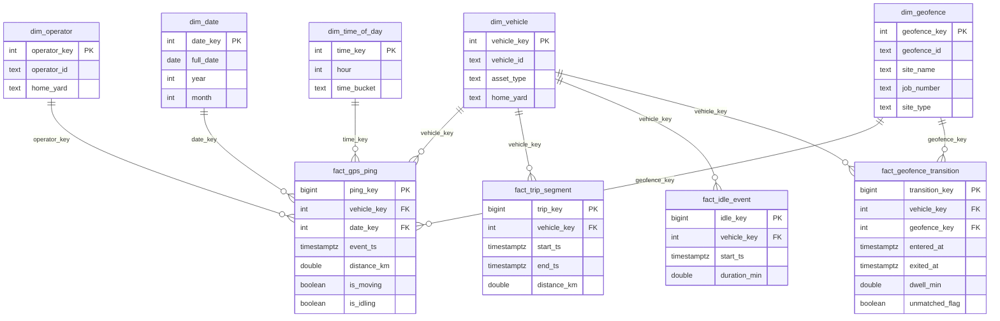

# Power BI semantic model

## Star schema



## Relationships and cardinality

| From | To | Cardinality | Cross-filter |
| --- | --- | --- | --- |
| fact_gps_ping[vehicle_key] | dim_vehicle[vehicle_key] | many-to-one | single |
| fact_gps_ping[operator_key] | dim_operator[operator_key] | many-to-one | single |
| fact_gps_ping[geofence_key] | dim_geofence[geofence_key] | many-to-one | single |
| fact_gps_ping[date_key] | dim_date[date_key] | many-to-one | single |
| fact_gps_ping[time_key] | dim_time_of_day[time_key] | many-to-one | single |
| fact_trip_segment[vehicle_key] | dim_vehicle[vehicle_key] | many-to-one | single |
| fact_idle_event[vehicle_key] | dim_vehicle[vehicle_key] | many-to-one | single |
| fact_geofence_transition[vehicle_key] | dim_vehicle[vehicle_key] | many-to-one | single |
| fact_geofence_transition[geofence_key] | dim_geofence[geofence_key] | many-to-one | single |

`geofence_key` and `operator_key` are nullable in `fact_gps_ping` (pings outside
any geofence / with no operator) and relate as many-to-one with blank rows
allowed.

## Storage mode

- **Import** for the dimensions and the `vw_*` aggregate views (fast visuals).
- **Dual** for `dim_date` / `dim_time_of_day` (used by both Import visuals and
  DirectQuery measures).
- **DirectQuery** is supported for `fact_gps_ping` if the org prefers live data;
  switch the partition's storage mode in Tabular Editor. The views are written
  to be sargable for DirectQuery.

## Incremental refresh

Configure an incremental-refresh policy on the large fact tables using the
Power BI `RangeStart` / `RangeEnd` parameters mapped to `dim_date[full_date]`:

- Store 3 years, refresh 30 days.
- Parameterized partition filter:
  `fact_gps_ping[event_ts] >= RangeStart and fact_gps_ping[event_ts] < RangeEnd`.
- Detect data changes on a `modified`/`event_ts` column; schedule the refresh
  after the ELT/DQ job completes (GitHub Actions can trigger it via the Power BI
  REST API).

## Row-level security (RLS)

Create roles on `dim_vehicle` keyed by `home_yard`:

```dax
[home_yard] = "YARD-01"
```

Assign each yard superuser to their yard's role; add an `ALL` role mapped to
corporate. RLS filters propagate to the facts through the star-schema
relationships.
